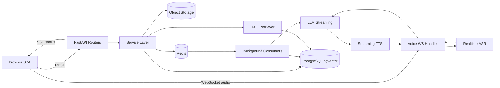

# Career智面

基于 FastAPI 与 LangChain 构建的语音 AI 面试平台，把简历评估、知识库检索、实时语音面试与结构化评估报告串成一条可运行的链路。

## 项目背景与目标

准备技术面试的人通常只能拿到题库和标准答案，缺少针对自己简历的追问，也缺少开口说一遍的机会。文本形式的模拟面试会把口头表达这一层抹掉，而停顿、改口、临场组织语言恰恰是真实面试里最难的部分。

项目目标是把一次面试完整地跑一遍：上传简历得到画像，按岗位与技术栈出题，用语音一问一答，最后产出一份可复盘的分项报告。在工程上，这意味着必须同时处理三件事——实时语音链路的时序、长耗时模型调用与请求生命周期的解耦、以及检索质量对回答质量的影响。

## 功能特性

- 简历解析与评估：异步分析简历，输出分项评分、优势与改进建议，可导出 PDF 报告
- 模拟面试：依据简历、技能或 JD 生成题目与追问，结束后给出逐题评估与整体报告
- 实时语音面试：WebSocket 双向流式，ASR 实时转写、LLM 流式追问、TTS 分句合成，面试过程按 INTRO / TECH / PROJECT / HR 阶段组织
- 知识库问答：文档上传与分块向量化，检索侧做查询改写与动态召回，回答流式返回
- 知识库面试：从知识库内容生成题目并发起定向面试
- 模型供应商可配置：供应商、密钥与默认模型在库中管理，运行时可切换

## 技术栈

| 类别 | 技术 |
| --- | --- |
| 后端框架 | Python 3.12、FastAPI、Uvicorn、Pydantic v2 |
| 数据访问 | SQLAlchemy 2（async）、asyncpg、Redis 异步客户端 |
| AI / LLM | LangChain（langchain-openai）、DashScope 实时 ASR 与 TTS SDK、OpenAI 兼容协议 |
| 向量与存储 | PostgreSQL + pgvector、S3 兼容对象存储（boto3） |
| 缓存与消息 | Redis（会话缓存、Stream 消费组） |
| 实时通信 | WebSocket、SSE |
| 文档处理 | pypdf、python-docx、reportlab |
| 前端 | React 18、TypeScript、Vite 5、Tailwind CSS 4、React Router 7 |
| 部署 | Uvicorn、前端 Dockerfile + Nginx |
| 测试 | pytest、pytest-asyncio |

## 系统架构



后端按路由、业务服务、数据访问、模型四层组织，AI 客户端、Redis、对象存储与文档解析放在基础设施层，配置与日志集中在配置层。语音面试不经过普通 REST 路径，而是走独立的 WebSocket 处理器：音频帧和 token 流的节奏与请求响应完全不同，混在一起会让两者的超时与背压互相牵连。耗时在分钟级的模型任务（简历分析、面试评估）不在请求生命周期内执行，改由 Redis Stream 投递，应用启动时挂载的后台消费者负责执行，前端通过 SSE 观察状态变化。检索被单独抽成一层，让问答、知识库面试和题目生成共用同一套召回逻辑。

## 核心设计与技术挑战

### 实时语音对话的链路与时序

- 挑战：一个对话回合里，语音识别分段、模型生成、语音合成三条流的速度并不一致，任一段阻塞都会让候选人对着沉默说话；句级合成还必须保证播放顺序与原句一致。
- 思路：把回合拆成转写累积、流式生成、句级合成三个解耦环节，以句子作为最小调度单位。各句的合成并发执行，但按句序串行下发，避免后一句抢在前一句之前播放。合成通道与会话绑定并提前预热，固定开场白的音频单独缓存，把冷启动移出对话时序。

### 异步任务的状态外置

- 挑战：简历分析、面试评估都依赖大模型，耗时不可预测。放进请求里会超时，放进进程内队列会在重启或扩容时丢任务。
- 思路：用 Redis Stream 消费组承载任务，投递、消费确认、超时消息认领与重试次数都记录在流上，进程崩溃后消息仍可被其他消费者接手。任务状态持久化到数据库，作为唯一可信来源；评估进度通过 SSE 推送状态变化，前端不需要轮询。

### 检索质量的三处修正

- 挑战：口语化提问与文档表述之间存在措辞差异，单次向量检索容易召回偏移；固定召回数量又会同时伤害短问句（信息不足）与长问句（噪声过多）。
- 思路：检索前先做查询改写，并与原问题的检索并行执行，改写结果命中就优先采用，未命中则回退原问题，避免改写失败连带拖慢主链路。召回数量与相似度阈值按问题长度分档。流式回答先经过一个探测窗口再透传，防止"未检索到"的模板话术被逐字念给用户。

### 向量与业务数据的一致性

- 挑战：一份文档同时存在于对象存储、业务表和向量表三处，任何一步失败都会留下"文档可见但检索不到"或孤儿向量这类中间状态。
- 思路：上传路径把业务记录与向量写入放进同一个事务提交，失败整体回滚并把失败原因记录在业务记录上，用户可以看到状态而不是面对空白。删除文档时按元数据先清向量再删记录，重复上传用文件内容哈希拦截。

### 模型供应商的可配置与调用层收敛

- 挑战：不同供应商在协议、密钥、超时和结构化输出能力上都有差异。如果这些差异散落在业务代码里，每次换模型都要改业务逻辑。
- 思路：供应商配置与密钥持久化在库中，密钥加密存储、只在服务端解密。进程启动时把启用中的供应商装配成一份快照，业务侧只按供应商标识取客户端。客户端按供应商复用并统一超时与连接池，配置变更后整体重建。结构化输出统一走带重试与修复提示的封装，把解析失败收敛在一处。

## 快速开始

环境要求：Python 3.12 及以上；PostgreSQL 并启用 pgvector；Redis；S3 兼容对象存储；可用的模型与语音服务凭证。

```bash
cd yudi-interview-backend
pip install -e ".[dev]"
uvicorn app.main:app --reload --host 0.0.0.0 --port 8000
```

配置从 `yudi-interview-backend/.env` 读取，变量名参考同目录的 `.env.example`。至少需要：`DB_HOST`、`DB_PORT`、`DB_NAME`、`DB_USERNAME`、`DB_PASSWORD`、`REDIS_HOST`、`REDIS_PORT`、`STORAGE_ENDPOINT`、`STORAGE_ACCESS_KEY`、`STORAGE_SECRET_KEY`、`STORAGE_BUCKET`、`AI_BAILIAN_API_KEY`、`CORS_ORIGINS`；生产环境还需要 `APP_AI_CONFIG_ENCRYPTION_KEY`。表结构在应用启动时由模型定义创建。前端是独立的 Vite 应用，开发服务器把 `/api` 代理到后端。
